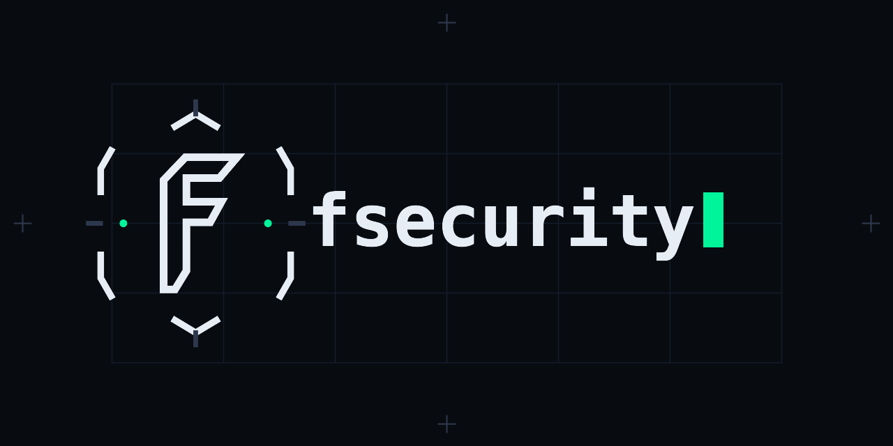
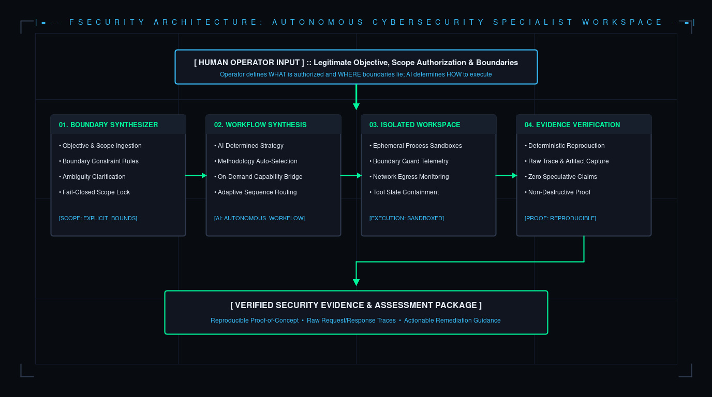
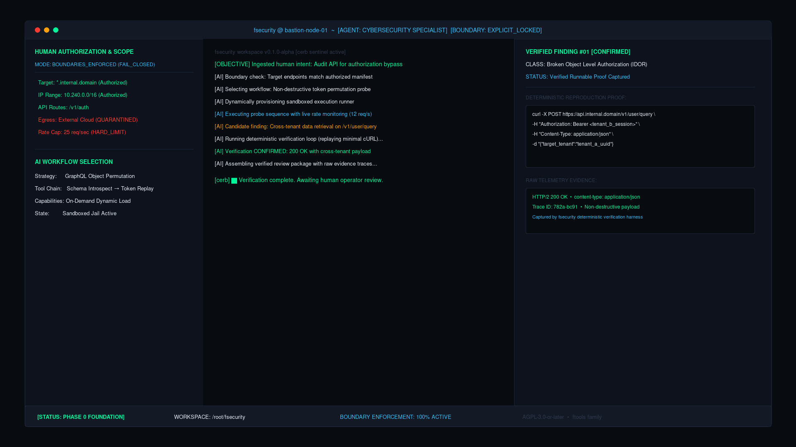
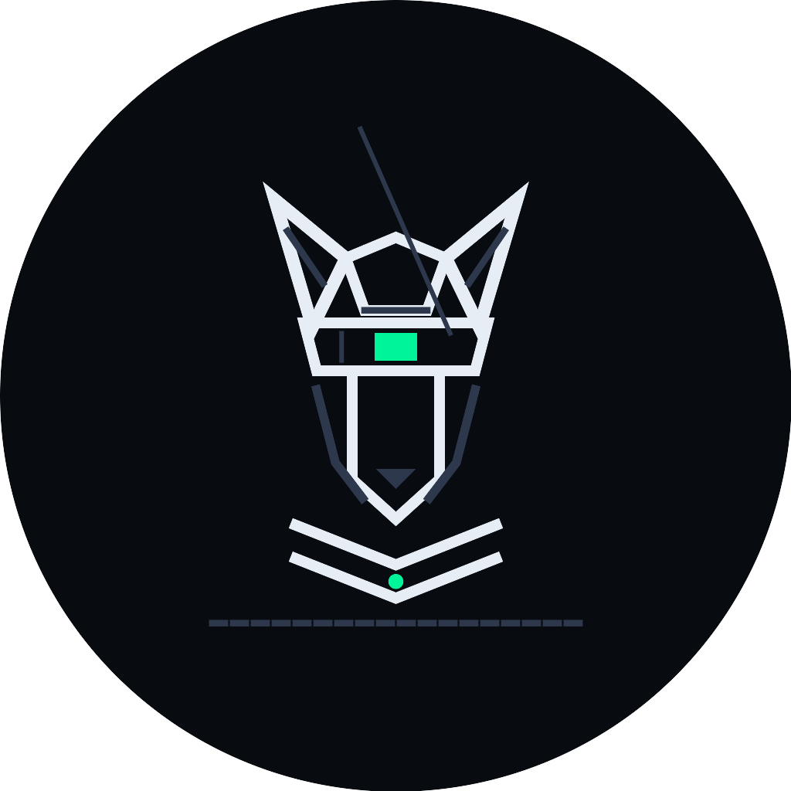

<div align="center">



# fsecurity

**An AI-native cybersecurity workspace and specialist toolkit.**  
*Human defines boundaries and objectives; the specialist AI determines its workflow.*

[](LICENSE)
[](docs/ROADMAP.md)

</div>

---

## What is fsecurity?

`fsecurity` is an AI-native cybersecurity workspace and specialist toolkit engineered to give an autonomous cybersecurity-specialist agent the environment, interfaces, and organization it needs for legitimate reconnaissance, bug bounty research, security assessment, and authorized penetration testing.

Most AI security tools treat the model either as a passive conversational chatbot—requiring the human operator to manually paste scan outputs, interpret headers, and script every probe—or as an unconstrained script that risks spraying traffic outside authorized network boundaries.

`fsecurity` establishes a clear operational contract:

1. **The Human Operator** defines legitimate target objectives, authorization parameters, and strict scope boundaries.
2. **The Specialist Agent** determines its own workflow, capability sequencing, diagnostic hypotheses, and testing methodology within those boundaries.
3. **The Workspace Harness** enforces scope boundaries before any packet is transmitted, provides isolated ephemeral execution environments, and requires deterministic, runnable proof before any vulnerability is reported.

---

## The Problem: The Scope and Orchestration Tax

In contemporary AI-assisted security workflows, researchers face four pervasive failure modes:

1. **Scope creep & boundary drift:** Babysitting prompts to ensure models do not spray traffic across out-of-scope domains, shared cloud infrastructure, or third-party APIs.
2. **Context rot:** Overloading context windows with thousands of lines of raw port scans and HTTP dumps until the model loses track of authorization rules.
3. **Speculative, unverified claims:** Triaging AI-generated vulnerability reports that sound convincing in text but fail completely when executed against target endpoints.
4. **Interface friction:** Juggling between chat windows, bloated graphical tools, and disconnected terminal shells.

`fsecurity` eliminates this manual coordination: you declare the scope and rules of engagement, and the agent executes its assessment inside a boundary-enforced harness that requires runnable proof for every finding.

---

## The Operational Model

Rather than relying on conversational conjecture, `fsecurity` structures security operations across five functional tiers:

```
[OPERATOR OBJECTIVE & SCOPE]
             |
             v
[TIER 1: SCOPE SYNTHESIS & BOUNDARIES]  --> Compiles targets, audits CIDR/routes, validates authorization
             |
             v
[TIER 2: CAPABILITY ORCHESTRATION]     --> Specialist agent selects skills, tools, and MCP servers on demand
             |
             v
[TIER 3: ISOLATED WORKSPACE HARNESS]   --> Executes probes in ephemeral sandboxes with live rate monitoring
             |
             v
[TIER 4: RUNNABLE PROOF VERIFICATION]  --> Executes deterministic reproduction checks and collects raw traces
             |
             v
[VERIFIED SECURITY ASSESSMENT PACKAGE]
```

<div align="center">
  
</div>

### 1. Scope Synthesis & Boundary Validation
Before sending any network probe or DNS request, the Scope Synthesizer compiles target manifests, CIDR ranges, domain wildcards, and active rules of engagement. It halts immediately if boundaries are ambiguous or underspecified, requiring explicit operator confirmation before traffic is permitted.

### 2. Autonomous Capability Selection
The specialist agent selects its own assessment workflow and capability sequence. Capabilities load strictly on demand—rather than stuffing inactive scanner schemas into the prompt, the agent activates specific security skills and Model Context Protocol (MCP) servers only when needed.

### 3. Isolated Ephemeral Sandboxing
Assessment probes and scripts execute in isolated, ephemeral sandboxes. Multiple tasks run concurrently without cross-contaminating workspace state, while a telemetry daemon monitors outbound rates and error response codes.

### 4. Deterministic Proof Verification
No vulnerability is reported without runnable proof. The harness automatically runs deterministic reproduction checks, capturing raw request/response pairs, minimal reproduction commands (such as standalone cURL invocations), and execution traces. Speculative anomalies that cannot be reproduced are discarded.

### 5. Verified Review Package
The final output is a structured review package containing an executive summary, validated reproduction commands, raw evidence logs, and remediation guidance.

---

## Interface Concept

`fsecurity` is designed terminal-native from day one: fast, keyboard-driven, and focused on security craft rather than marketing chrome.

<div align="center">
  
  <br />
  <sub><i>Concept preview of the fsecurity terminal interface in an active workspace. This illustrates target interface ergonomics, not shipped functionality.</i></sub>
</div>

---

## Brand & Visual Identity

`fsecurity` is part of the `ftools` product family alongside its code intelligence sibling, `fcode`. While preserving the shared family lineage—specifically the canonical angular `f` glyph geometry—`fsecurity` features an original visual identity built around cybersecurity defense and boundary enforcement.

### The Emblem: The Bastion Reticle

<div align="center">
  
  <br />
  <sub><b>The Bastion Reticle</b>: Segmented hexagonal defense brackets enclosing the canonical <code>f</code> with Electric Phosphor telemetry nodes</sub>
</div>

* **Segmented Hexagonal Perimeter:** Six perimeter brackets forming an outer defense bastion ring.
* **Cardinal Calipers:** Orthogonal engineering ticks at cardinal axes for structural precision.
* **Electric Phosphor Telemetry Nodes:** Nodes at `(396, 256)` and `(116, 256)` representing active scope authorization.
* **Canonical `f`:** Razor-cut angular glyph carrying the shared `ftools` family lineage.

### Mascot: cerb (The Bastion Sentinel Hound)

<div align="center">
  
  <br />
  <sub><b>cerb</b>: The Bastion Sentinel Hound</sub>
</div>

`cerb` is the official `fsecurity` mascot—a cybernetic sentinel hound constructed entirely from terminal character geometry and perimeter defense iconography:
* **Radar Scanning Ears:** Dual faceted angular scanning ears with inner telemetry channels.
* **Cranial Crown & Brow Divider:** Faceted skull plate framing tactical sensor hardware.
* **Transverse Optical Scanner Visor:** Panoramic sensor visor with an Electric Phosphor (`#00F59B`) scanner band.
* **Snout & Faceted Mandibles:** Articulated muzzle line with triangular olfactory sensor.
* **Tactical Collar:** Dual-band armored collar centered with an active telemetry node.
* **Terminal Baseline:** Dashed monospaced ground rule.

For complete specifications, color tokens, and asset inventories, consult [`DESIGN.md`](DESIGN.md).

---

## Project Structure & Roadmap

Development is organized across three clear perspectives:

### 1. Current Reality (Phase 0 Foundation)
This repository is currently at **Phase 0 (Foundation)**:
* **Brand & Visual Foundation:** Canonical vector masters, automated generator (`scripts/generate_brand.py`), and test suite (`scripts/verify_brand.py`) enforcing 7 mathematical invariants.
* **Agent Governance Architecture:** Universal agent rules in [`AGENTS.md`](AGENTS.md), scoped rules in [`.claude/rules/`](.claude/rules/), and security reporting policy in [`SECURITY.md`](SECURITY.md).
* **Architecture Specifications:** Core thesis in [`docs/ARCHITECTURE.md`](docs/ARCHITECTURE.md) and architectural boundaries in [`docs/DECISIONS_AND_NON_GOALS.md`](docs/DECISIONS_AND_NON_GOALS.md).
* **Foundation Integrity:** Automated link and repository hygiene verification (`scripts/verify_foundation.py`).

*There are no binary packages published yet. Engine implementation begins in Phase 1 following human review.*

### 2. Committed Product Principles
* **Scope Before Packets:** No probe, packet, or DNS lookup without verified authorization.
* **Agent Autonomy Inside Scope:** The agent chooses its own workflow and tools; the human defines the bounds.
* **Deterministic Verification:** Zero unverified vulnerability claims in final reports.
* **Local-First Authority:** Local workspace files and git logs remain the authoritative source of truth.

### 3. Future Candidates
* **Native Engine Runtime:** Evaluating high-performance native implementations (e.g. Rust static binary) for sub-20ms startup and low memory footprint.
* **Universal Provider Streaming:** Streaming abstraction across major proprietary, open-weights, and local model backends.
* **Ephemeral Process Sandboxes:** OS-level isolation (e.g. Linux namespaces/cgroups) for concurrent, safe execution.
* **Documentation Portal:** Evaluating static documentation frontends (e.g. Starlight) powered by portable Markdown.

For the full milestone schedule, consult [`docs/ROADMAP.md`](docs/ROADMAP.md).

---

## License

`fsecurity` is licensed under the **GNU Affero General Public License v3.0 or later** ([AGPL-3.0-or-later](LICENSE)).

See [`LICENSE`](LICENSE) for the full license text.

